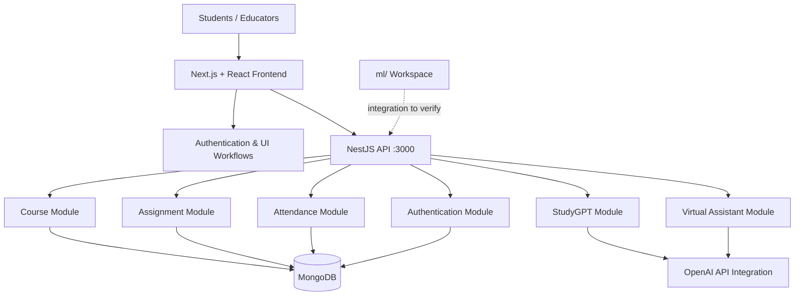

<div align="center">

# 🎓 EduVerse

### An AI-Assisted Education & Academic Management Platform

**Learn • Collaborate • Organize • Grow**

[](https://nextjs.org/)
[](https://react.dev/)
[](https://nestjs.com/)
[](https://www.typescriptlang.org/)
[](https://www.mongodb.com/)
[](https://tailwindcss.com/)

[Overview](#-overview) · [Features](#-key-features) · [Architecture](#-system-architecture) · [Getting Started](#-getting-started) · [API](#-api-overview) · [Roadmap](#-roadmap)

</div>

---

## 📖 Overview

**EduVerse** is a full-stack educational platform that combines academic workflows with AI-assisted learning capabilities. Its application code is organized into a **Next.js frontend**, a **NestJS REST backend**, and a separate **machine-learning workspace**.

The platform provides backend modules for managing courses, assignments, attendance, user authentication, and AI-generated study suggestions. The frontend uses modern UI libraries and includes dependencies for calendars, charts, real-time communication, and collaborative experiences.

> **Project status:** This README documents features confirmed from accessible repository code and identifies integrations that need configuration or verification. It does not claim a live production deployment or validated ML performance.

## ✨ Key Features

| Area | What's implemented / available |
| --- | --- |
| 📚 **Courses** | Backend routes to create, list, retrieve and update course records |
| 📝 **Assignments** | Backend routes to create, list, retrieve and update assignments |
| 📅 **Attendance** | Create attendance records, retrieve records by email and update attendance status |
| 🤖 **StudyGPT** | Prompt-based endpoint designed to generate AI study suggestions |
| 💬 **Virtual Assistant** | Separate prompt-based assistant endpoint for study suggestions |
| 🔐 **Authentication** | Registration and login endpoints, with JWT and Passport dependencies in the backend |
| 📊 **Frontend UI** | Next.js interface with UI, chart and scheduling packages |
| 🤝 **Collaboration tooling** | Liveblocks, Socket.IO client and ZEGOCLOUD packages included in frontend dependencies; specific end-to-end workflows should be verified |
| 🧠 **ML workspace** | Dedicated `ml/` folder; consult its source files before asserting particular algorithms or results |

## 🏗️ System Architecture



**Architecture notes:** The MongoDB connection is configured through Mongoose in the backend. Both AI service implementations call an OpenAI completion endpoint. The `ml/` directory is shown separately because its runtime integration could not be confirmed.

## 🛠️ Technology Stack

| Layer | Technologies |
| --- | --- |
| **Frontend** | Next.js 14, React 18, TypeScript, Tailwind CSS |
| **UI & data visualization** | Radix UI, Framer Motion, Recharts, Chart.js, React Big Calendar |
| **Authentication & collaboration packages** | Clerk, Liveblocks, Socket.IO, ZEGOCLOUD |
| **Backend** | NestJS 10, Node.js, TypeScript, REST controllers |
| **Database** | MongoDB, Mongoose |
| **Backend security libraries** | Passport, JWT, bcrypt |
| **AI integration** | OpenAI API via Axios |
| **Testing / developer tools** | Jest, ESLint, Prettier |

> Listed packages are present in dependency manifests; their presence does not necessarily mean every integration is fully configured.

## 📂 Repository Structure

```text
nfc3_fullyDeveloped/
├── backend/
│   ├── src/
│   │   ├── auth/                 # Authentication
│   │   ├── courses/              # Course management
│   │   ├── assignment/           # Assignment management
│   │   ├── attendance/           # Attendance tracking
│   │   ├── study-gpt/            # AI study suggestions
│   │   ├── virtual-assistant/    # AI assistant
│   │   ├── auxi/                 # Auxiliary NestJS module
│   │   ├── app.module.ts         # Module registration / database connection
│   │   └── main.ts               # NestJS application bootstrap
│   └── package.json
├── frontend/
│   ├── app/                       # Next.js application routing
│   ├── components/                # UI components
│   ├── contexts/                  # React context providers
│   └── package.json
├── ml/                             # Machine-learning-related code
├── .gitignore
└── package-lock.json
```

*Structure reflects verified files and referenced imports; it is a high-level guide rather than an exhaustive directory listing.*

## 🚀 Getting Started

### Prerequisites

- A supported **Node.js** installation and npm (Node.js 20 LTS is a reasonable starting choice for this dependency generation).
- Access to a **MongoDB** database.
- An **OpenAI API key** if you intend to use the AI endpoints.
- Any frontend provider credentials required by the particular features you enable (for example, Clerk or Liveblocks).

### 1. Clone the repository

```bash
git clone https://github.com/purav-12345/nfc3_fullyDeveloped.git
cd nfc3_fullyDeveloped
```

### 2. Configure the backend

```bash
cd backend
npm install
```

Create `backend/.env` locally (do not commit this file):

```dotenv
MONGODB_URI=mongodb+srv://<username>:<password>@<cluster>/<database>
OPENAI_API_KEY=your_openai_api_key
PORT=3000
```

**Important configuration step:** The checked-in `backend/src/app.module.ts` currently contains a hard-coded MongoDB connection string. Replace it with `process.env.MONGODB_URI` (ideally using NestJS configuration management), rotate the exposed database credentials, and ensure the backend loads your `.env` file. The current `backend/src/main.ts` explicitly listens on port `3000`; the `PORT` variable will not override this until the bootstrap code is updated.

Then run:

```bash
npm run start:dev
```

Backend default: `http://localhost:3000`

### 3. Configure and start the frontend

Open a second terminal:

```bash
cd nfc3_fullyDeveloped/frontend
npm install
npm run dev
```

Frontend default: `http://localhost:3000`

⚠️ **Port conflict:** The checked-in backend and the default Next.js development server both use port **3000**. Until this is corrected in the application configuration, start the frontend on another port:

```bash
npm run dev -- -p 3001
```

Then browse to `http://localhost:3001`.

**Integration note:** Examine frontend API base URLs and third-party credentials before trying complete UI workflows. Running both servers does not automatically guarantee that every feature is wired to the correct backend URL.

## 🔌 API Overview

The following routes were verified from NestJS controllers:

| Method | Route | Purpose |
| --- | --- | --- |
| `POST` | `/auth/register` | Register a user |
| `POST` | `/auth/login` | Log in |
| `GET` | `/courses` | List courses |
| `POST` | `/courses` | Create course |
| `GET` | `/courses/:id` | Get course |
| `PUT` | `/courses/:id` | Update course |
| `GET` | `/assignments` | List assignments |
| `POST` | `/assignments` | Create assignment |
| `GET` | `/assignments/:id` | Get assignment |
| `PUT` | `/assignments/:id` | Update assignment |
| `GET` | `/attendance` | List attendance records |
| `POST` | `/attendance` | Create attendance record |
| `GET` | `/attendance/:email` | Get attendance by email |
| `PUT` | `/attendance/:id/status` | Update attendance status |
| `POST` | `/study-gpt/suggestions` | Request AI study suggestions |
| `POST` | `/virtual-assistant/suggestions` | Request virtual assistant suggestions |

Example request shape for the AI modules:

```bash
curl -X POST http://localhost:3000/study-gpt/suggestions \
  -H "Content-Type: application/json" \
  -d '{"prompt":"Suggest a study plan for learning data structures"}'
```

> **AI compatibility note:** Both AI services currently reference the legacy `text-davinci-003` completion model. These calls may fail with current OpenAI APIs until upgraded to a supported model and endpoint. Do not interpret the example request as confirmation of successful output without making that change.

## 🖼️ Application Preview

Add real screenshots of the running application under `docs/screenshots/` and uncomment these lines after the images exist:

<!--
| Landing Page | Dashboard |
| --- | --- |
|  |  |

| Courses | AI Study Assistant |
| --- | --- |
|  |  |
-->

Suggested captures: landing/sign-in screen, main dashboard, course management, assignment/attendance view, and AI assistant. Use actual application screenshots rather than mockups presented as working features.

## 🧪 Development and Testing

Backend scripts available from `backend/package.json`:

```bash
cd backend
npm run build       # Compile NestJS app
npm run lint        # Run ESLint (may apply fixes)
npm test            # Run Jest tests
npm run test:cov    # Generate test coverage
npm run test:e2e    # Run e2e tests when configured
```

Frontend scripts:

```bash
cd frontend
npm run build
npm run lint
```

No test pass rate or deployment status is claimed here.

## 🔒 Security & Configuration Notes

Before deploying or sharing a public demonstration:

1. **Rotate the MongoDB credentials exposed in the repository source and Git history.** Removing the string in a new commit alone does not invalidate previously exposed credentials.
2. Move database connection settings and API secrets into properly managed environment variables; keep `.env` files out of version control.
3. Review endpoint authentication and authorization, particularly modifications to course, assignment and attendance records.
4. Migrate the AI integrations to supported APIs/models and add appropriate error handling and request limits.
5. Configure safe CORS origins and validate third-party integration permissions before production deployment.

## 🤝 Contributing

Issues and pull requests are welcome. For changes, describe the problem, explain the proposed behavior, and include relevant test steps. Avoid committing secrets, credentials or private student information.
---

<div align="center">

**EduVerse — bringing academic management and AI-assisted learning into one platform.**

[⬆ Back to top](#-eduverse)

</div>
